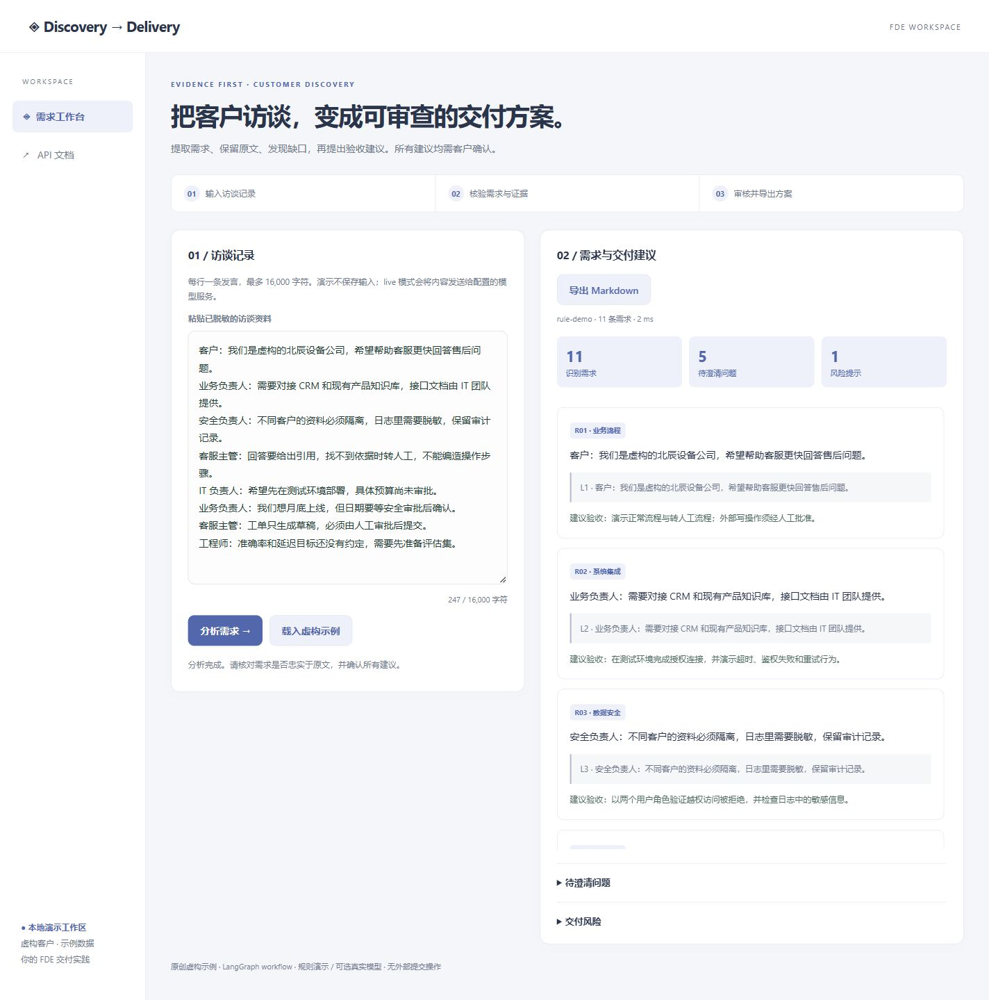
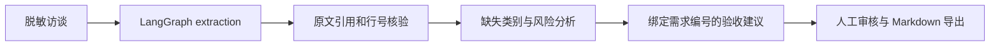

# Discovery → Delivery

**面向 FDE 的客户需求发现与交付方案助手。** 将脱敏访谈转换为需求清单、原文证据、澄清问题、交付风险和建议验收标准，并导出 Markdown。

与 [FieldDesk Copilot](https://github.com/Suqs259/fielddesk-copilot) 的售后 RAG 场景形成互补：本项目关注客户发现和交付范围定义。

## 使用效果与攻略

[完整中文使用攻略](docs/usage-guide.md)：安装启动、推荐演示流程、结果解读、真实模型配置及常见问题。

以下为实际运行截图，使用虚构示例数据与演示模式。



## Run

Python 3.10+：

```bash
python -m venv .venv
# Windows: .venv\Scripts\activate
# macOS / Linux: source .venv/bin/activate
pip install -r requirements.txt
python -m uvicorn app.main:app --port 8001 --reload
```

访问 http://localhost:8001 ，点击“载入虚构示例”再分析。API 文档：`/docs`。

也可以使用 `docker compose up --build`，仅映射本机 8001 端口。

## What it does

- **需求分类**：系统集成、安全、质量、交付、业务流程。
- **证据追溯**：每条需求保留引用和原始行号，服务端丢弃不匹配的引用。
- **缺口发现**：分别显示缺少信息的问题和仍需确认的问题。
- **验收建议**：每项建议绑定需求编号，始终标记为待客户审核。
- **数据边界**：不写数据库或文件，不记录访谈正文；live 模式会把内容发送至模型服务。默认框架仍有请求路径访问日志。
- **导出报告**：浏览器本地生成 Markdown 文件。

## Workflow



默认 `MODEL_MODE=demo` 使用可解释的关键词规则，不调用模型，不假装具有完整自然语言理解。`live` 模式使用 LangChain `ChatOpenAI.with_structured_output` 按 Pydantic schema 提取，再执行相同的服务端证据核验。

## Live mode

```powershell
$env:MODEL_MODE="live"
$env:OPENAI_API_KEY="your-key"
$env:OPENAI_MODEL="gpt-4o-mini"
python -m uvicorn app.main:app --port 8001
```

`.env.example` 是参考，不会自动加载。请使用账号可访问且支持结构化输出的模型。真实模型调用可能产生费用。不要提交密钥或未授权客户资料。

## Verification

```bash
python -m pytest -q
```

覆盖证据追溯、虚构引用丢弃、需求到验收映射、缺口识别、输入限制、导出及模拟模型提取。不使用真实客户数据，也不把 mock 测试当成真实模型效果评估。

## Delivery notes

虚构试点：设备企业希望引入 AI 售后助手，但需求分散在业务、安全和 IT 的访谈中。FDE 用本工具整理第一版需求，带着缺口问题回访，确认范围后才能制定项目排期。

验收：示例中的五类需求均能识别；引用可逐行核对；每条建议可追溯至需求；缺乏证据时不产生承诺；用户能下载完整报告。

## Limits

规则模式会误识别否定句、历史背景和讨论中的非需求，且一行可能产生多类需求。模型模式也可能误解语义。原文匹配只能验证引用存在，不能证明需求推断正确。当前澄清问题与验收建议是分类模板，不是个性化排期，也不自动处理冲突或评定优先级。16000 字符输入限制与最多 40 条需求用于控制上下文；没有长文分片或持久记忆。

当前为本机作品集 MVP，无登录、限流或生产审计。公开部署之前需要接入身份认证、滥用防护和客户数据治理。Docker 与真实模型是否实测见交付记录，不应仅根据配置文件推断已验证。

下一步：由业务专家标注访谈测试集，评估需求 precision/recall、证据忠实度与遗漏率；再增加需求冲突检测、人工修订及经过批准的项目管理工具同步。

参考：[LangGraph Graph API](https://docs.langchain.com/oss/python/langgraph/graph-api)。代码与示例独立编写，MIT License。
