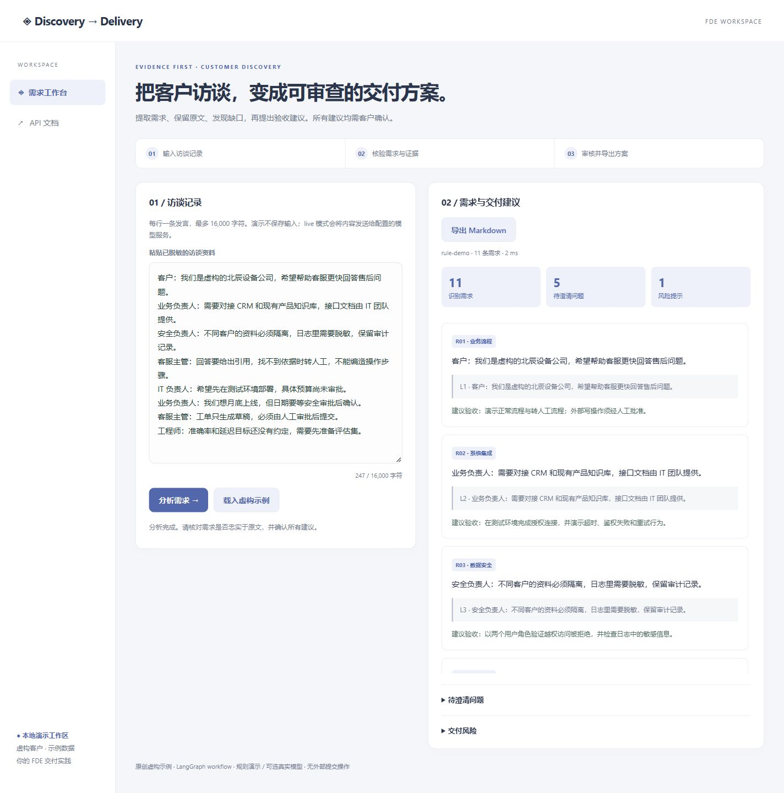

# Discovery → Delivery 使用攻略

## 1. 安装与启动

准备 Python 3.10+ 与 Git：

```bash
git clone https://github.com/Suqs259/discovery-to-delivery.git
cd discovery-to-delivery
python -m venv .venv
```

Windows PowerShell 激活：`.venv\Scripts\Activate.ps1`；macOS / Linux：`source .venv/bin/activate`。如脚本激活被禁止，可用 `.venv\Scripts\python.exe` 直接执行下面的命令。

```bash
python -m pip install -r requirements.txt
python -m uvicorn app.main:app --host 127.0.0.1 --port 8001
```

打开 http://127.0.0.1:8001 。保持终端运行，Ctrl+C 停止。默认无需模型密钥。GitHub 仓库包含代码和截图，使用页面需本地启动。

## 2. 三分钟演示

1. 点击 **载入虚构示例**，观察输入框与字数统计。
2. 点击 **分析需求**，等待分析完成。
3. 查看结果概览。内置示例当前生成 **11 条需求、5 个澄清问题、1 条风险提示**；规则或示例变更后数量可能变化。
4. 逐条比较需求、`L1` 等原文行号与引用，检查分类和验收建议是否适用。
5. 展开 **待澄清问题** 与 **交付风险**，整理下一次客户访谈的问题。
6. 点击 **导出 Markdown**，在浏览器下载目录找到 `discovery-report.md`。报告需人工审核后使用。



## 3. 自己准备访谈

建议每行一条发言，写出发言角色、系统、业务动作与约束。最多 16,000 字符，当前最多提取 40 条需求。可复制下面的虚构例子：

```text
业务负责人：我们希望接入 CRM，为客服生成售后工单草稿。
安全负责人：客户资料必须按角色隔离，日志需要脱敏。
客服主管：回答要提供引用，证据不足时转人工。
IT 负责人：先在测试环境部署，预算和上线时间需要另行审批。
业务负责人：准确率和延迟目标尚未确定，需要先建立评估集。
```

只写“帮我做一个智能助手”通常不足以形成可交付需求。可以补充谁使用、要解决什么问题、需要接入哪里、什么结果算成功。

## 4. 如何解读结果

| 内容 | 含义 |
| --- | --- |
| R01、R02 | 本次报告内的需求编号，并非永久项目编号 |
| 系统集成 / 数据安全 / 质量评估 / 项目交付 / 业务流程 | 需求的五种分类；同一行可能属于多个分类 |
| L1、L2 与原文引用 | 对应输入资料中的原始行号；服务端丢弃无法对齐原文的引用 |
| 建议验收 | 按分类生成的模板建议，尚未得到客户认可 |
| 缺少信息 | 当前未识别到该类需求，建议回访补充 |
| 待确认 | 已有相关需求，但细节和标准仍需确认 |

默认 `rule-demo` 使用关键词规则，可能误识别否定句和背景信息。原文匹配只能证明引用存在，不能证明推断正确。请人工删改重复、不适用或误解的内容。

## 5. 使用真实模型

PowerShell 设置后重新启动服务：

```powershell
$env:MODEL_MODE="live"
$env:OPENAI_API_KEY="你的模型密钥"
$env:OPENAI_MODEL="gpt-4o-mini"
```

选择账号可访问且支持结构化输出的模型。live 模式会将访谈传给模型服务，可能产生费用；只使用已获授权和脱敏的数据。`.env.example` 不自动加载。恢复演示时设置 `$env:MODEL_MODE="demo"` 并重启。

## 6. 常见问题

| 现象 | 处理 |
| --- | --- |
| 页面打不开或端口冲突 | 确认服务运行；必要时改为 `--port 8011` 并访问新端口 |
| 提取不到需求 | 补充明确业务描述；规则模式主要识别示例中的关键词 |
| 一条发言出现多个分类 | 当前按类别分别保留，不自动去重为单一业务需求 |
| 修改输入后仍看到旧结果 | 点击分析需求重新生成；导出的是上次成功分析的报告 |
| 导出按钮不可用 | 先完成一次成功分析；在浏览器下载记录查找文件 |
| 模型模式报 502 | 检查密钥、模型结构化输出支持及网络；切回 demo 可排查 |

## 7. 面试展示顺序

讲清访谈记录为什么不能直接变成开发任务，再演示需求到原文证据的映射、缺口问题和人工确认。最后导出报告，解释如何让客户确认范围、标注评估集和定义验收阈值。本项目不自动生成可靠排期、不进行客户承诺，也不向外部项目管理系统写入。运行 `python -m pytest -q` 可复现自动测试。
